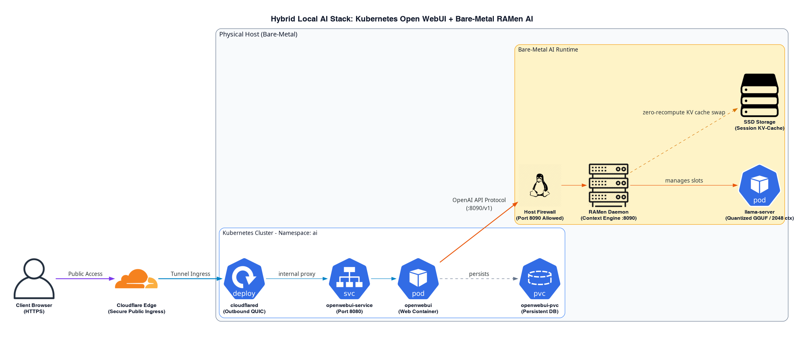

# Hybrid Local AI: Kubernetes Open WebUI + Bare-Metal RAMen AI

A high-efficiency, zero-recomputation local AI infrastructure running on modest server hardware. 

This setup combines a **Kubernetes-hosted Open WebUI** frontend exposed securely via **Cloudflare Tunnel** with a **Bare-Metal RAMen AI Context Engine** on the host OS to eliminate container CPU throttling, constrain context size to prevent CPU freezes, and persist KV-cache attention slots directly to NVMe/SSD.

---

## Architecture Diagram



```text
[ Browser / User ]
        │ (HTTPS)
        ▼
[ Cloudflare Edge: Secure Public Ingress ]
        │
        ▼ (Outbound QUIC Tunnel - Zero Inbound Ports)
┌────────────────────────────────────────────────────────────────────────┐
│ Kubernetes Cluster - Namespace: ai                                     │
│                                                                        │
│  [ cloudflared ] ───► [ openwebui-service:8080 ]                       │
│                              │                                         │
│                              ▼                                         │
│                     [ openwebui Pod ] ───► [ openwebui-pvc (2Gi) ]     │
│                              │              (Users & Chat History)     │
│                              │                                         │
└──────────────────────────────┼─────────────────────────────────────────┘
                               │ OpenAI API Protocol (:8090/v1)
                               ▼
┌────────────────────────────────────────────────────────────────────────┐
│ Bare-Metal Host Runtime                                                │
│                                                                        │
│  [ Host Firewall: Port 8090 Allowed ]                                  │
│        │                                                               │
│        ▼                                                               │
│  [ RAMen AI Daemon (:8090) ]                                           │
│        │                                                               │
│        ├──► [ llama-server ] (Quantized GGUF / 2048 Context)           │
│        │                                                               │
│        └──► [ SSD Storage ] (Session KV-Cache)                         │
│             (Zero-Recompute Slot Swapping in ~50ms)                    │
└────────────────────────────────────────────────────────────────────────┘
```

---

## The Engineering Challenge & Solution

### 1. Dual-Core CPU & Memory Bottlenecks
Running local LLMs on resource-constrained processors poses severe constraints:
* **8B Model Overload**: Large models require massive memory bandwidth and compute operations per token. On low-power CPUs without dedicated GPUs, prompt processing locks the system for minutes.
* **Unconstrained Context Windows**: When inference servers allocate **19,000 to 51,000 token context windows**, calculating attention matrices across long contexts paralyzes dual-core systems.
* **The Solution**: 
  1. Downscale to a compact, high-efficiency quantized model (such as a 3B or 4B GGUF).
  2. Enforce a strict context window of **2,048 tokens** (`--ctx 2048`).
  3. Maximize parallel execution across logical CPU threads.

### 2. Why Run RAMen Bare-Metal Outside Kubernetes?
* **Zero Container/Cgroups Throttling**: Direct access to AVX instruction sets without container virtualization layers.
* **Persistent Model & Cache Directory**: Models and session snapshots live permanently on host storage without re-downloading on container restarts.
* **Direct Network Access**: Open WebUI in Kubernetes connects directly to the host IP (`http://<HOST-IP>:8090/v1`) through the local firewall.

### 3. How RAMen AI Eliminates Prompt Prefill Latency
In standard inference engines (vanilla llama.cpp or Ollama):
* Every turn in a conversation forces the model to re-read and compute the mathematical Key-Value attention states for **all previous messages** (Prompt Evaluation).
* On low-power CPUs, a 1,500-token chat history requires 30 to 60 seconds of 100% CPU time before emitting token 1.

With RAMen AI:
* RAMen captures the computed **KV cache vectors** in memory after each generation.
* **SSD Slot Swapping**: When switching chats or when an idle timeout triggers, RAMen snapshots the binary KV matrices to disk on the SSD.
* **Instant Recall**: When resuming a conversation, RAMen reads the session back into memory in ~50ms, skipping the prompt prefill phase entirely.

---

## Repository Structure

```text
.
├── diagram.py                         # Python diagrams script generating architecture.png
├── docs/
│   └── architecture.png               # High-resolution visual system diagram
└── k8s/
    ├── 01-deployment-openwebui.yaml   # Open WebUI deployment (configured for host:8090)
    ├── 02-service-openwebui.yaml      # ClusterIP service for Open WebUI (port 8080)
    ├── 03-pvc-openwebui.yaml          # 2Gi storage for SQLite database & user sessions
    └── kustomization.yaml             # Single-command Kustomize bundle
```

---

## Step-by-Step Deployment Guide

### Phase 1: Host Preparation

#### 1. Open Port 8090 in Host Firewall
Allow pod network traffic to access port 8090:

```bash
sudo firewall-cmd --add-port=8090/tcp --permanent
sudo firewall-cmd --reload
```

#### 2. Install RAMen AI
```bash
curl -fsSL https://getramenai.com/install.sh | bash
export PATH="$HOME/.ramen/bin:$PATH"
```

#### 3. Start RAMen with 2048 Context Limit
```bash
ramen start qwen3-4b --ctx 2048 --host 0.0.0.0 --port 8090
```

Verify the local model server is healthy:
```bash
curl http://127.0.0.1:8090/v1/models
```

---

### Phase 2: Kubernetes Deployment

#### 1. Configure the Target Host IP
In `k8s/01-deployment-openwebui.yaml`, verify `OPENAI_API_BASE_URL` matches your host's local IP address:
```yaml
- name: OPENAI_API_BASE_URL
  value: "http://<YOUR-HOST-IP>:8090/v1"
```

#### 2. Deploy Open WebUI
```bash
kubectl apply -k k8s/
```

#### 3. Verify Pod and In-Cluster Access
```bash
kubectl get pods,svc -n ai
kubectl exec -it -n ai deploy/openwebui -- curl -s http://<YOUR-HOST-IP>:8090/v1/models
```

---

## Operational Verification

### Check Context Memory & Active Slots
```bash
ramen status
```
* Displays active conversation slots currently resident in RAM.
* Confirms the 2,048 token limit per slot.

### Inspect Saved KV-Cache on SSD
```bash
ls -lh ~/.context-engine/sessions/
```
Shows serialized binary cache files persisted to disk for instant conversation resumption without CPU recalculation.
