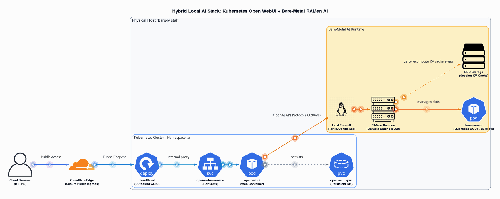

# Hybrid Local AI: Kubernetes Open WebUI + Bare-Metal RAMen AI

A lightweight, zero-recomputation private AI stack combining a **Kubernetes-hosted Open WebUI** frontend with a bare-metal **RAMen AI Context Engine** on the host.

This architecture eliminates prompt prefill lag on resource-constrained hardware by swapping persistent KV-cache attention slots directly to SSD and enforcing a strict 2,048-token context window.

---

## Architecture & Data Flow



* **Public Ingress**: Outbound Cloudflare QUIC tunnel routes traffic to Open WebUI with zero open router ports.
* **In-Cluster Frontend**: Open WebUI runs in Kubernetes with persistent SQLite storage for users and chat history.
* **Bare-Metal Inference**: Open WebUI queries the host RAMen daemon over the local network (`:8090/v1`), providing unthrottled CPU AVX performance.
* **Zero-Recompute KV Cache**: Attention states snapshot to SSD (`~/.context-engine/sessions`) for sub-second conversation resumption without CPU recalculation.

---

## Live Verification

Chatting in real-time with local model inference served through the hybrid pipeline:


---

## Why This Architecture?

| Challenge | Standard Containerized Inference | Hybrid Bare-Metal + RAMen AI |
| :--- | :--- | :--- |
| **Prompt Prefill (TTFT)** | Recalculates entire chat history every turn (30-60s CPU lockup) | Restores KV-cache from SSD in ~50ms (Zero-Recompute) |
| **Context Window** | Unconstrained 19K-51K tokens freeze low-power CPUs | Strict 2,048-token cap (`--ctx 2048`) maintains fluid token output |
| **CPU Execution** | Throttled by container cgroups virtualization | Direct bare-metal execution with full AVX instructions |
| **Public Exposure** | Requires port forwarding or dynamic DNS | Encrypted outbound Cloudflare QUIC tunnel |

---

## Quickstart

### 1. Host Preparation
Allow the port in the host firewall, install RAMen, and start the model server:

```bash
# Allow port 8090 from pod network
sudo firewall-cmd --add-port=8090/tcp --permanent && sudo firewall-cmd --reload

# Install and launch RAMen with 2K context
curl -fsSL https://getramenai.com/install.sh | bash
ramen start qwen3-4b --ctx 2048 --host 0.0.0.0 --port 8090
```

Verify the local model endpoint:
```bash
curl http://127.0.0.1:8090/v1/models
```

### 2. Kubernetes Deployment
Deploy the Open WebUI stack using Kustomize:

```bash
kubectl apply -k k8s/
```

Verify the pod and internal connectivity:
```bash
kubectl get pods -n ai
kubectl exec -it -n ai deploy/openwebui -- curl -s http://<HOST-IP>:8090/v1/models
```

---

## Project Structure

```text
.
├── diagram.py                         # Generates architecture diagram & animated GIF
├── docs/
│   ├── architecture.gif               # Animated data flow GIF (1760x703, HD)
│   ├── architecture.png               # High-resolution static topology
│   └── openwebui ss.png               # Live chat verification screenshot
└── k8s/
    ├── 01-deployment-openwebui.yaml   # Open WebUI deployment (configured for host:8090)
    ├── 02-service-openwebui.yaml      # ClusterIP service (port 8080)
    ├── 03-pvc-openwebui.yaml          # Persistent storage for user chats
    └── kustomization.yaml             # Kustomize manifest bundle
```
